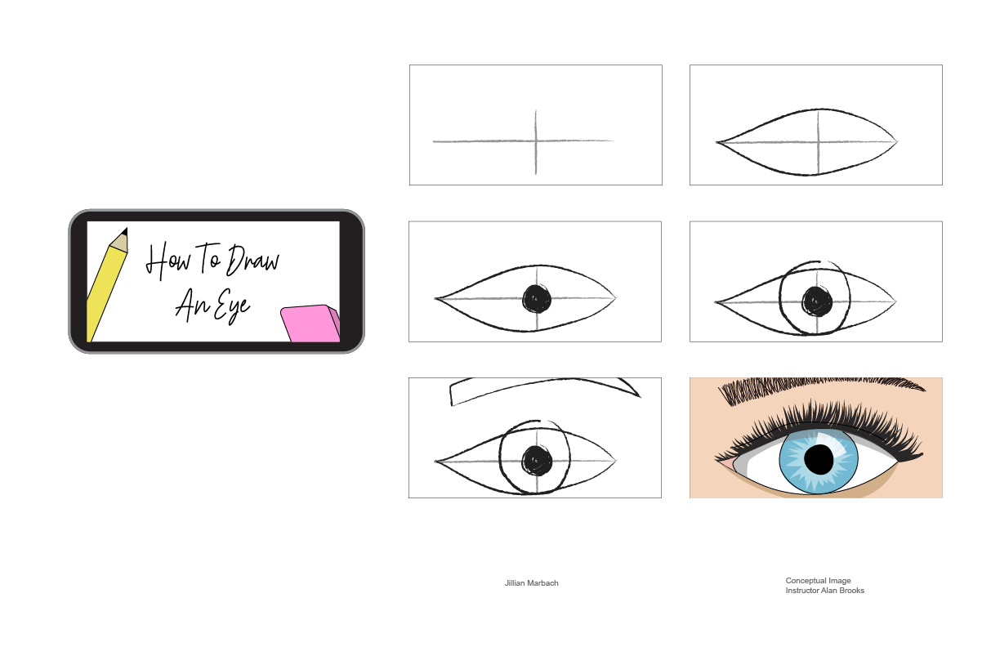

This project was designed to be a set of six instructions with no words. The final product became a play on traditional drawing tutorials—the steps are super simple until the very end where everything is magically polished and you're left wondering how they did it.

*Made with Illustrator for AAV 252*
