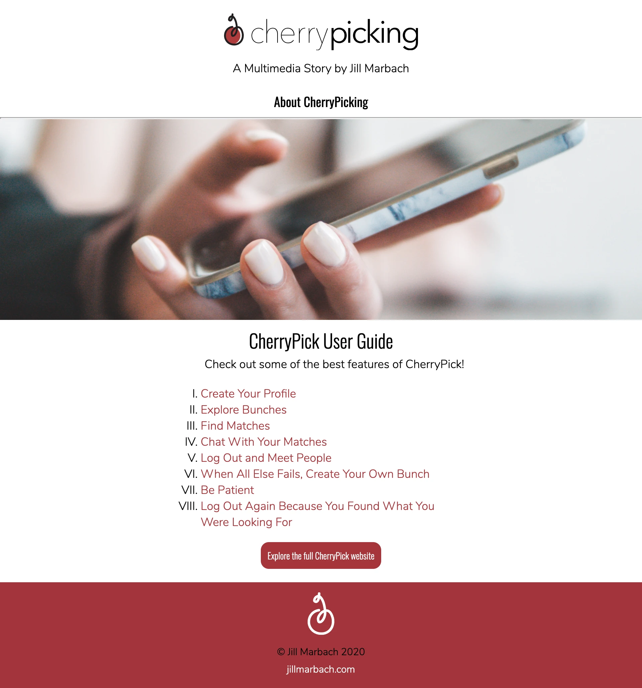

[cherrypickingstory.site](http://cherrypickingstory.site/) is a short story that combines web design, branding, graphic design, gifs and storytelling into an eight part story about Mayes' experience with a new dating app, CherryPick.

*Made using HTML, CSS, Javascript, Illustrator and Photoshop*
