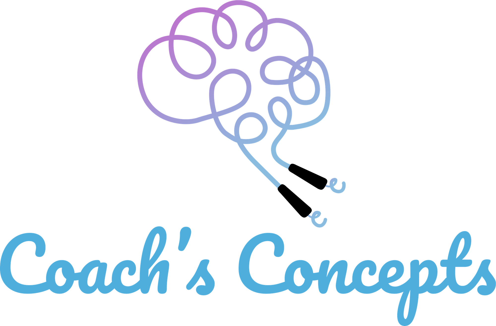
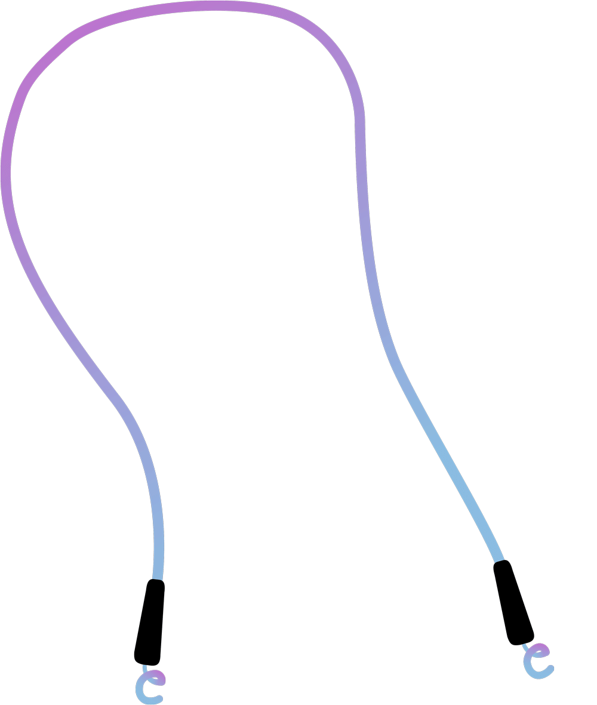
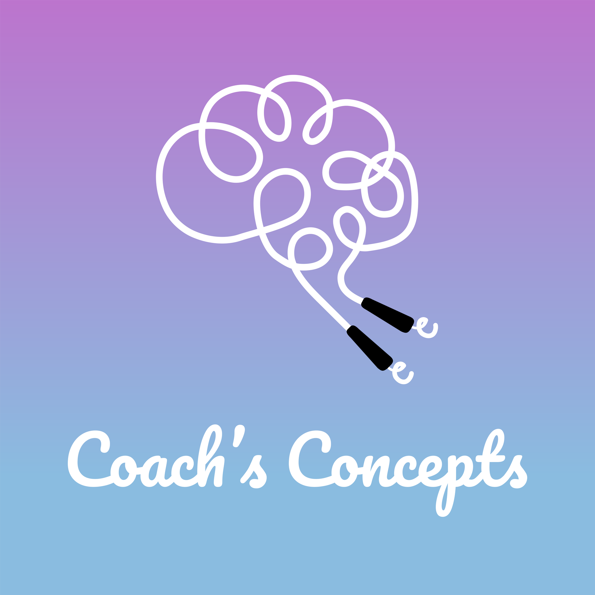

This logo was created for a freelance client for their business, a wellness, psychology and coaching advice website called Coach's Concepts. I worked with this client on a few different iterations, finally landing on this design that combines a jump rope and a brain. I also created an animation of this logo and a podcast cover. [You can find Coach’s  Concepts here.](https://instagram.com/coachsconcepts?igshid=5yduytsmmfaf)

*Made for a freelance client using Illustrator for the logo and Photoshop for the gif*
