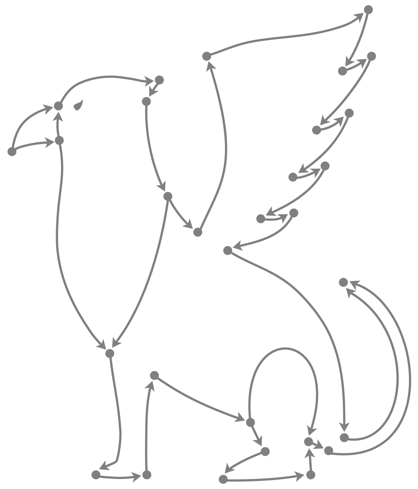

This logo was created for a [software project](https://github.com/TomerAberbach/grfn) that executes dependency graphs. The lines and points that make up the griffin image are an example of the kind of graph this software computes.

*Made for a freelance client with Illustrator and After Effects*
