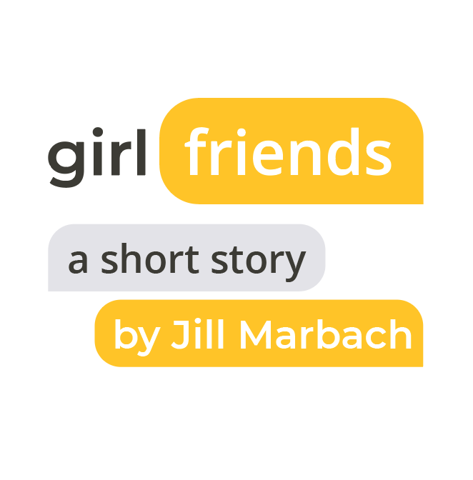

*Girlfriends* is a short story about two women who match on a dating app - one who thinks she's swiping for friends and the other who's looking for love. Want to know more? Watch the [Girlfriends trailer](https://youtu.be/Uket_ZhuxKo)

You can read *[Girlfriends](/files/girlfriends.pdf)* now.

*The trailer was made using Illustrator, After Effects and Premiere Pro. The short story was made using InDesign, Illustrator, and Photoshop.*
