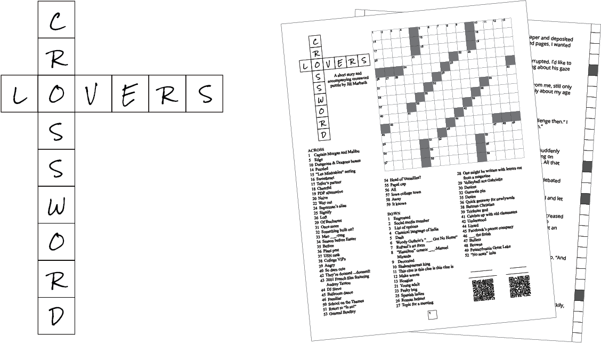

Crossword Lovers is a short story and accompanying crossword puzzle, both created by Jill Marbach. Read as two people fall for one another while they complete a crossword, and try your own hand at that same puzzle!

Read [Crossword Lovers](/files/crossword-lovers-story.pdf) here and solve the [crossword puzzle](https://crosshare.org/crosswords/00vEa0ePz9Abjx5OUJx0/crossword-lovers-a-short-story) online (or check out the [answer key](/files/crossword-lovers-answers.png)).
